# 费用审计技能 · 能力拓扑（expense-audit-v2）

> `expense-audit-v2` v0.2.26 · **离线确定性** · 只算事实，不下结论
> 可视化版本：[`docs/expense-audit-topology.html`](expense-audit-topology.html)（自包含离线，浏览器直接打开）
>
> 数字均从 `skills-v2/expense-audit-v2/` 代码自动抽取：**43 条规则 · 33 个标准字段 · 14 个参数 · 46 个配置键 · 默认 0 次联网**。

---

## 一、主干流程

```mermaid
flowchart LR
  subgraph IN[① 输入]
    A1[主台账 CSV/XLSX]
    A2[policy.json 制度]
    A3[--field-map 字段映射]
    A4[6 类可选辅助数据]
  end
  subgraph WASH[② 洗涤与映射]
    W1[33 个标准字段自动别名]
    W2[中文日期/多列金额]
    W3[坏行隔离 bad_rows]
    W4[状态过滤 status_filter]
  end
  subgraph CORE[③ 规则引擎 · 10 个域]
    C1[A 重复与复用]
    C2[B 制度与阈值]
    C3[C 时序与日期]
    C4[D 行为与集中度]
    C5[E 统计离群]
    C6[F 凭证真实性]
    C7[G 外部核验]
    C8[H 差旅交叉]
    C9[I 时空]
    C10[J 数据治理]
  end
  subgraph OUT[④ 输出]
    O1[dashboard.html / summary.md]
    O2[findings.csv / findings.jsonl]
    O3[evidence.jsonl / run_manifest.json]
    O4[data_quality.md / clean / bad_rows]
    O5[可选 excluded_by_status / suppressed_findings]
  end
  IN --> WASH --> CORE --> OUT
  OUT -.->|取数/核验结果| IN
```



---

## 二、规则族全景（43 条，按域分组）

| 域 | 规则（`finding_type`） | 需要的关键字段 |
|---|---|---|
| **A 重复与复用**（9） | `exact-duplicate-invoice` 发票号重复 · `exact-duplicate-employee-date-amount` 同员工同日同金额 · `near-duplicate` 金额近似 · `cross-employee-invoice` 发票跨人复用 · `shared-voucher-multiple-employees` 同一凭证多人各报 · `ticket-number-reused` 同一票号重复 · `same-amount-no-invoice` 同商户同额无发票 · `high-frequency-small-amount` 高频小额 · `resubmit-after-rejection-amount-increase` 撤回重提加码 | employee_id · expense_date · amount · invoice_number · pnr · ticket_number · vendor_name · status |
| **B 制度与阈值**（7） | `policy-threshold` 超制度上限 · `split-expense` 拆单 · `split-expense-cross-merchant` 跨商户拆单 · `large-amount-low-level-approval` 大额低层级审批 · `large-amount` 绝对大额 · `row-limit-exceeded` 超适用差标 · `unit-price-above-market` 单价高于参考市场价 | amount · expense_type · approver · row_limit · nights · unit_price |
| **C 时序与日期**（8） | `submit-before-expense` 提交早于消费 · `future-date` 未来日期 · `cross-period` 跨期入账 · `ticket-issue-after-flight` 出票晚于行程 · `weekday-mismatch` 日期与周几不符 · `weekend-signal` 周末 · `holiday-signal` 节假日 · `lodging-night-mismatch` 晚数与入离店不符 | expense_date · submit_date · issue_date · check_in · check_out · nights · weekday |
| **D 行为与集中度**（4） | `self-approval` **自审自批（支持多人审批列表）** · `vendor-concentration` 商户集中度 · `consecutive-nightly-invoicing` 连续逐晚开票 · `space-time-conflict` 时空冲突 | employee_id · approver · vendor_name · origin/dest_city |
| **E 统计离群**（1） | `robust-outlier` 同类中异常高额（**相对**，非绝对） | amount · expense_type · currency |
| **F 凭证/票据真实性**（9） | `voucher-incomplete` 凭证要素不全 · `sequential-invoice` 发票连号 · `invoice-format-anomaly` 发票格式异常 · `itinerary-segment-conflict` 订座号同日航段矛盾 · `missing-expense-type` 缺费用类型 · （票号重复/出票倒挂见 A、C） | invoice_number · invoice_date · ticket_number · pnr · flight_no |
| **G 外部核验**（6，**需外部数据**） | `travel-verification-mismatch` 行程核验不符 · `travel-verification-not-found` 行程核验未找到 · `invoice-payee-mismatch` 开票方≠实际收款方（替票） · `shipment-amount-mismatch` 运单勾稽不一致 · `shipment-without-tracking` 运单缺单号 · `shipment-from-private-address` 疑似私人地址 | flight_no · travel_date · payee · invoice_issuer · tracking_no · from/to_addr |
| **H 差旅交叉**（3，**需辅助数据**） | `expense-without-travel-request` 差旅无出差申请 · `office-swipe-on-offsite-claim` 称外地但当天公司打卡 · `attendance-city-mismatch` 打卡城市不符 | 出差申请 / 打卡记录 |

> 「I 时空」已并入 `space-time-conflict`，「J 数据治理」体现在 `bad_rows` / `data_quality.md` / `status_filter` / 跳过规则里（不是 finding）。

---

## 三、可选输入 → 唤醒哪些能力（**不给 = 与旧版逐字一致**）

| 参数 | 你提供什么 | 新增的规则 | 不提供时 |
|---|---|---|---|
| `--policy` | 制度 JSON（限额/审批阈值/节假日…） | 超制度上限 · 拆单 · 大额低层级审批… | 相关规则自动跳过并说明 |
| `--field-map` | 确认后的字段映射 | （修正映射，减少误报） | 自动猜别名 |
| `--travel-requests` | 出差申请单 | 差旅无出差申请 | 不参与 |
| `--attendance` | 打卡/考勤 | 称外地但当天公司打卡 · 打卡城市不符 | 不参与 |
| `--travel-verification` | 外部航班核验结果 | 行程核验不符 / 未找到 | 不参与（**查不到 ≠ 虚构**） |
| `--payments` | 支付/收款记录 | 开票方 ≠ 实际收款方（替票） | 不参与 |
| `--price-reference` | 市场价格参考 | 单价高于参考市场价 | 不参与 |
| `--shipments` | 运单台账 | 运单勾稽 / 缺单号 / 疑似私址 | 不参与 |
| `--allowlist` | 白名单（已知无风险） | （压制，写 `suppressed_findings.csv`） | 不参与 |

**帕累托保证**：以上每一项都是**可选**；不给 → 完全等同旧版；给了 → 才多出对应能力。

---

## 四、输出物（9 件 + 2 可选）

| 文件 | 性质 | 给谁看 |
|---|---|---|
| `dashboard.html` | 自包含离线全景图，第一屏执行摘要 | 经理 / 管理层 |
| `summary.md` | 完整结论（含业务实质性声明、建议复核顺序） | 审计师 |
| `findings.csv` / `findings.jsonl` | 逐条发现（结构化） | 审计师 / 机器 |
| `evidence.jsonl` | 每条 finding 的证据（可回源到源行） | 复核追溯 |
| `run_manifest.json` | 输入/脚本哈希、参数、`network_access: false` | 可复现性 |
| `data_quality.md` | 字段映射、空值率、**警告与跳过规则** | 数据体检 |
| `clean_expenses.csv` / `bad_rows.csv` | 标准化结果 / 坏行隔离 | 数据面 |
| `excluded_by_status.csv`（可选） | 按审批状态排除的行 | 不静默丢弃 |
| `suppressed_findings.csv`（可选） | 被白名单压制的告警（留痕） | 不静默丢弃 |

---

## 五、边界与红线

**它不能做**
- **不判断业务实质**（费用是否真实发生）；
- **不做舞弊 / 拒付认定**——异常 ≠ 舞弊；
- **不联网**、不连银行流水；**不做发票验真**（那需要外部数据，见 G）；
- 制度阈值只能来自**你给的制度**。

**人工必查（脚本不覆盖）**：发票真伪 · 关联交易与利益冲突 · 票据原始凭证 · 报销业务实质 · 关联方资金往来 · 审批权限匹配。

> **两句话记住它**：① 机器负责**全量找线索**，人负责**定性**；② **未发现问题 ≠ 没有问题**。

---

## 六、典型闭环

```
1 拿台账（费用/报销明细 + 制度）
2 跑技能（不给任何可选输入也行）
3 看 dashboard + summary（先查 high/medium 线索）
4 需要更深？加辅助数据（出差 / 打卡 / 运单 / 收款方 / 市场价 …）
5 人工核实 + 定性（回到 evidence 对应源行）
```

> 导入后**先看 `data_quality.md` 的「警告与跳过规则」**——它会明确告诉你哪些规则因缺字段被跳过。
